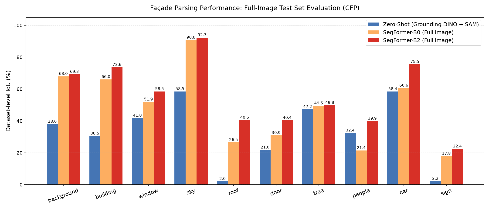
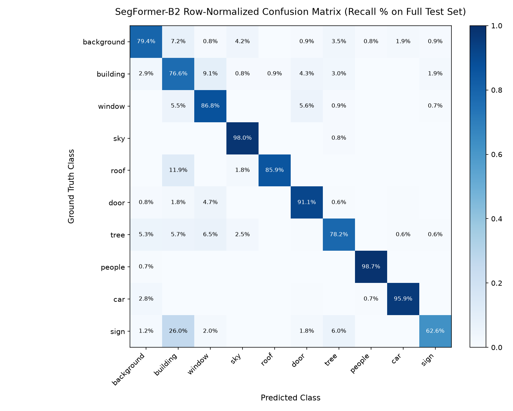
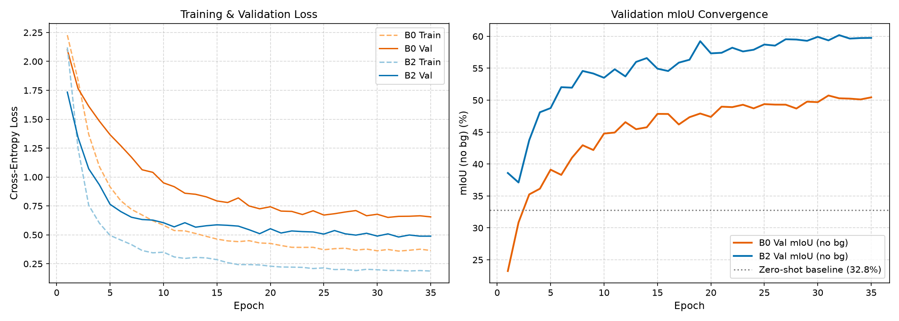
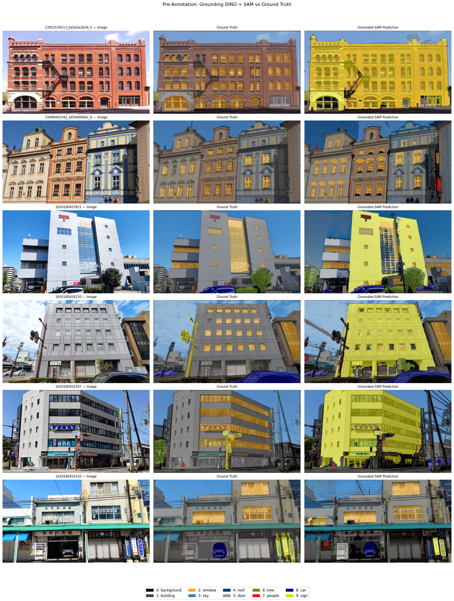
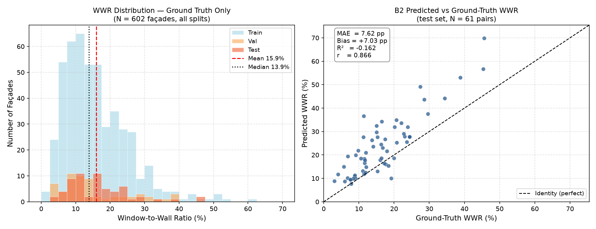

# Building Façade Parsing Prototype

> **Context:** A technical prototype demonstrating a reproducible model-assisted annotation and semantic segmentation pipeline for street-level façade imagery and aperture analysis. This implements and evaluates an established pipeline and is not novel research.

Street-view façade images present severe challenges: perspective distortion, angled viewpoints, partial occlusion by trees, vehicles, and pedestrians. This project builds and benchmarks a reproducible end-to-end pipeline across four stages:

1. **Zero-Shot Pre-Annotation** — open-vocabulary detection + promptable segmentation (Grounding DINO + SAM) to explore label bootstrapping without manual annotation.
2. **Supervised Fine-Tuning** — SegFormer-B0 and SegFormer-B2 (pretrained on ADE20K) fine-tuned with a new 10-class head, using class-weighted cross-entropy loss.
3. **Full-Image Evaluation** — dataset-level mIoU (with and without background) on 61 held-out test images, evaluated with longest side resized to 1024 px.
4. **WWR Estimation** — downstream Window-to-Wall Ratio prediction from B2 segmentation masks, with pred-vs-GT comparison.

---

## Table of Contents

- [Results Summary](#1-results-summary)
- [Per-Class IoU Comparison](#2-per-class-iou-comparison)
- [Visualizations](#3-visualizations)
- [Pre-Annotation Evaluation](#4-pre-annotation-evaluation-zero-shot-pilot)
- [Training Details](#5-training-details)
- [WWR Analysis](#6-window-to-wall-ratio-wwr-analysis)
- [Limitations](#7-limitations)
- [Project Structure](#8-project-structure)
- [Quickstart](#9-quickstart--reproducibility)
- [Credits](#10-credits)

---

## 1. Results Summary

All headline metrics are evaluated on the **61-image held-out test set** (images resized to longest side 1024 px — identical preprocessing for all three methods):

| Model | mIoU (10 classes) | mIoU (no background) | Training |
| :--- | :---: | :---: | :---: |
| Zero-Shot (Grounding DINO + SAM) | 33.27% | 32.76% | None |
| SegFormer-B0 (fine-tuned) | 48.34% | 46.16% | 35 epochs on Kaggle T4 |
| **SegFormer-B2 (fine-tuned)** | **56.22%** | **54.77%** | 35 epochs on Kaggle T4 |

**Fine-tuning SegFormer-B2 improves mIoU by +22.95 pp over zero-shot and +7.88 pp over B0.**

> **Note — Training validation numbers (512×512 center-crop):** During training, validation was run on 512×512 center-crops for simplicity. Best crop-based val mIoU (no bg): B2 = 60.19% at epoch 32 (61.54% with background); B0 = 50.73% at epoch 31 (52.60% with background). Headline numbers above are from full-image inference and are the definitive test figures.
>
> **Note — Paper comparison:** RTFP (Wang et al.) sets `use_ignore=True`, excluding classes 6–9 (tree, people, car, sign) from evaluation. This pipeline trains and evaluates on all 10 classes; direct mIoU comparisons to RTFP are therefore not meaningful.

---

## 2. Per-Class IoU Comparison

Evaluated on the full test set (61 images, longest side 1024 px):

| Class | Zero-Shot | SegFormer-B0 | SegFormer-B2 | B2 vs Zero-Shot | B2 vs B0 |
| :--- | :---: | :---: | :---: | :---: | :---: |
| background | 37.95% | 67.97% | 69.27% | +31.32 pp | +1.30 pp |
| **building** | 30.47% | 66.02% | **73.62%** | +43.15 pp | +7.60 pp |
| **window** | 41.79% | 51.91% | **58.48%** | +16.69 pp | +6.57 pp |
| sky | 58.49% | 90.77% | **92.33%** | +33.84 pp | +1.56 pp |
| **roof** | 2.03% | 26.48% | **40.49%** | +38.46 pp | +14.01 pp |
| **door** | 21.75% | 30.90% | **40.37%** | +18.62 pp | +9.47 pp |
| tree | 47.24% | 49.47% | **49.82%** | +2.58 pp | +0.35 pp |
| people | 32.42% | 21.42% | **39.89%** | +7.47 pp | +18.47 pp |
| **car** | 58.44% | 60.62% | **75.51%** | +17.07 pp | +14.89 pp |
| sign | 2.18% | 17.84% | **22.45%** | +20.27 pp | +4.61 pp |
| **mIoU (10 cls)** | **33.27%** | **48.34%** | **56.22%** | **+22.95 pp** | **+7.88 pp** |
| **mIoU (no bg)** | **32.76%** | **46.16%** | **54.77%** | **+22.01 pp** | **+8.61 pp** |

### Key Findings

- **Domain gap is class-specific:** Zero-shot models collapse on domain-specific architectural structures — **roof** (2.0%) and **sign** (2.2%) — while performing reasonably on generic outdoor semantics (**sky** 58.5%, **tree** 47.2%).
- **Fine-tuning delivers the biggest gains on hard architectural classes:** B2 gains +43 pp on *building*, +38 pp on *roof*, +18 pp on *door* vs zero-shot.
- **B2 outperforms B0 across most classes**, with the largest gaps on *people* (+18.5 pp), *roof* (+14.0 pp), and *car* (+14.9 pp).
- **B0 is worse than zero-shot on people (21.4% vs 32.4%)**, suggesting the smaller model possibly underfits this class despite fine-tuning.
- **Sky approaches saturation** (90–92%) but *tree* (~50%) and *sign* (~2–22%) have significant headroom remaining.

---

## 3. Visualizations

### Per-Class IoU Bar Chart



### SegFormer-B2 Confusion Matrix

Row-normalized confusion matrix (values = per-row recall %) computed across **36.8 million test pixels**:



**Top-8 off-diagonal confusions (measured from confusion matrix):**

| GT class | Predicted as | Row fraction |
| :--- | :--- | :---: |
| sign | building | 26.0% |
| roof | building | 11.9% |
| building | window | 9.1% |
| background | building | 7.2% |
| tree | window | 6.5% |
| sign | tree | 6.0% |
| window | door | 5.6% |
| window | building | 5.5% |

**Window performance:** recall = 86.8%, precision = 64.2% — the model correctly identifies most window pixels but over-predicts windows in building and tree regions.

### Training Curves (SegFormer-B2, 35 epochs)



Training notes:
- Loss dropped sharply from 2.12 → 0.49 in the first 5 epochs; continued gradual improvement to epoch 35.
- Best val mIoU no-bg (crop): **60.19%** at epoch 32. Val loss plateaued after ~epoch 28.

### Zero-Shot Pre-Annotation Overlays

Sample overlays from Grounding DINO + SAM on test images:



---

## 4. Pre-Annotation Evaluation (Zero-Shot Pilot)

**Models:** Grounding DINO (`IDEA-Research/grounding-dino-base`) + SAM (`facebook/sam-vit-base`) via HuggingFace `transformers`.
**Hardware:** Kaggle T4 GPU. **Throughput:** ~10.8 s / image.
**Prompts:** Class names with trailing period (e.g., `"window."`) — required by Grounding DINO tokenizer.

### Segmentation Quality (dataset-level IoU, 61 test images)

| Class | Zero-Shot IoU |
| :--- | :---: |
| background | 37.95% |
| building | 30.47% |
| window | 41.79% |
| sky | 58.49% |
| roof | 2.03% |
| door | 21.75% |
| tree | 47.24% |
| people | 32.42% |
| car | 58.44% |
| sign | 2.18% |
| **mIoU** | **33.27%** |

### Aperture Detection Count Proxy

A count-based proxy for the correction effort the zero-shot output would require (not a measure of wall-clock annotation time):

| Class | Detected boxes | GT connected components | Boxes / GT components |
| :--- | :---: | :---: | :---: |
| Window | 1,930 | 1,238 | 1.56× |
| Door | 109 | 95 | 1.15× |

> GT connected components merge touching window panes into single regions, so this ratio is an empirical proxy only. The zero-shot overlays were not manually inspected.

---

## 5. Training Details

### Setup

| Config | Value |
| :--- | :--- |
| Dataset | Comprehensive Façade Parsing (CFP / RTFP) — 602 images |
| Split | 481 train / 60 val / 61 test (reproduced from RTFP 80/10/10 split) |
| **Backbone** | `nvidia/segformer-b0-finetuned-ade-512-512` and `nvidia/segformer-b2-finetuned-ade-512-512` — ADE20K-pretrained; only the final 150→10 class head is re-initialised |
| Image preprocessing | Resize longest side to 1024 px; then 512×512 random crop for training |
| Augmentation | Random horizontal flip (p=0.5), ColorJitter (brightness/contrast/saturation ±0.25) |
| Loss | CrossEntropyLoss with inverse-frequency class weights, capped at 10× median weight |
| Class weights (0–9) | 0.10, 0.03, 0.13, 0.08, 1.84, 0.59, 0.29, 4.42, 0.93, 1.60 |
| Optimizer | AdamW, lr = 6×10⁻⁵, weight decay = 0.01 |
| **Scheduler** | Cosine decay with 5% linear warmup (`get_cosine_schedule_with_warmup`) |
| **Mixed precision** | `torch.cuda.amp.autocast` + `GradScaler` (T4 GPU) |
| Batch size | B0 = 8, B2 = 4 |
| Epochs | 35 |
| **Checkpoint saving** | `checkpoint_latest.pt` every epoch (Kaggle session safety); `best_model.pt` on best val mIoU (no background) |
| Hardware | Kaggle T4 GPU (16 GB) |

### Validation mIoU During Training (512×512 center-crop)

| Epoch | B2 val mIoU (10 cls) | B2 val loss | B0 val mIoU (10 cls) | B0 val loss |
| :---: | :---: | :---: | :---: | :---: |
| 1 | 41.0% | 1.734 | 23.7% | 2.101 |
| 5 | 51.0% | 0.764 | 42.0% | 1.366 |
| 10 | 55.4% | 0.605 | 47.0% | 0.950 |
| 19 | 60.7% | 0.510 | 50.1% | 0.725 |
| **32** | **61.5%** ✓ best | **0.481** | — | — |
| **31** | — | — | **52.6%** ✓ best | **0.651** |
| 35 | 61.2% | 0.489 | 52.3% | 0.655 |

---

## 6. Window-to-Wall Ratio (WWR) Analysis

**Formula:**
```
WWR = window_pixels / (building_pixels + window_pixels + door_pixels)
```
*(CFP class indices — building: 1, window: 2, door: 5)*

> **Important caveat:** This is a pixel ratio in a perspective image, not a physical WWR. No geometric rectification is applied; occlusions (trees, people, vehicles) reduce the detected building area; and the viewing angle affects the apparent ratio of wall to glazing. Results should be interpreted as a relative indicator, not a physical building measurement.

**Exclusion rule:** A test-image pair is excluded if either the GT or predicted gross-façade area falls below 1,000 pixels. **0 of 61 test images were excluded.**

### Ground-Truth WWR Dataset Statistics *(GT masks only — not model accuracy)*

| Split | N | Mean | Std | Median | P25 | P75 |
| :--- | :---: | :---: | :---: | :---: | :---: | :---: |
| Train | 481 | 15.96% | 9.35% | 14.11% | — | — |
| Val | 60 | 15.17% | 9.91% | 11.74% | — | — |
| Test | 61 | 16.55% | 9.03% | 15.26% | — | — |
| **Overall** | **602** | **15.94%** | **9.38%** | **13.89%** | **9.30%** | **21.03%** |

### B2 Predicted vs Ground-Truth WWR — Test Set (61 images)

| Metric | Value | Interpretation |
| :--- | :---: | :--- |
| MAE | **7.62 pp** | Average absolute error per image |
| Bias (mean pred − GT) | **+7.03 pp** | Systematic over-prediction |
| Pearson r | **0.866** (p = 2×10⁻¹⁹) | Strong rank correlation |
| R² | −0.16 | Negative: bias inflates MSE above a constant-mean baseline |

**Interpretation:** B2 ranks façades by glazing ratio well (r = 0.87, p < 10⁻¹⁸), but systematically over-predicts WWR by ~7 pp. This is consistent with the observed window statistics: recall = 86.8% but precision = 64.2%, meaning the model predicts window pixels in regions that are actually building (9.1% of GT building pixels are predicted as window) or tree (6.5% of GT tree pixels predicted as window). R² is negative because the constant-mean predictor beats MSE when a large systematic offset is present.



*Left: GT WWR distribution across all 602 façades (train/val/test, ground truth only). Right: B2 predicted vs GT WWR on the 61 test images, with identity line, MAE, and R².*

---

## 7. Limitations

- **Small test set:** 61 test images, one evaluation run, no ensemble or seed averaging. Per-class IoU differences on rare classes (door, sign) should be treated as approximate.
- **Val-based model selection on a small split:** Best checkpoint selected by crop-mIoU on 60 validation images — results are sensitive to this split.
- **Zero-shot mask selection:** SAM mask index 2 was used instead of selecting by SAM's predicted scores; candidate mask IoU scores were not compared against ground truth, and overlays were not manually inspected.
- **Physical WWR not measured:** The computed WWR is a pixel ratio in a perspective image. Without geometric rectification, it is affected by viewing angle, occlusion, and distance. It is a relative indicator, not a physical building parameter.
- **No comparison with RTFP:** The pipeline was not benchmarked against the RTFP paper baseline (RTFP excludes classes 6–9, so direct comparison requires a separate evaluation run).
- **Domain shift unknown:** Models were trained and evaluated on CFP only. Performance on imagery from other cities such as Bolzano — with different architectural styles, camera setups, and weather — has not been tested.
- **This is not novel research:** The pipeline applies existing models (SegFormer, Grounding DINO, SAM) to an existing dataset (CFP/RTFP). Its value is in the reproducible implementation and evaluation.

---

## 8. Project Structure

```
facade-parsing-prototype/
├── data/                                 # ⚠ Not in repo — download separately (see below)
│   ├── cfp_raw/                          # Raw CFP dataset (original resolution)
│   └── cfp_processed/                    # Resized to longest 1024 px; 481/60/61 split
│       ├── train/ {images/, masks/}
│       ├── val/   {images/, masks/}
│       └── test/  {images/, masks/}
├── models/                               # ⚠ Not in repo — download from Kaggle output
│   ├── segformer_b0_best.pt              # Fine-tuned SegFormer-B0 weights (~14 MB)
│   └── segformer_b2_best.pt             # Fine-tuned SegFormer-B2 weights (~104 MB)
├── notebooks/
│   ├── 02_pre_annotation_excuted.ipynb  # Executed Grounding DINO + SAM notebook
│   └── 03_train_segformer.ipynb         # SegFormer B0/B2 fine-tuning on Kaggle
├── results/
│   ├── figures/
│   │   ├── model_comparison_iou.png     # Per-class IoU bar chart (all 3 methods)
│   │   ├── b2_confusion_matrix.png      # Row-normalised confusion matrix (B2)
│   │   ├── training_curves.png          # Loss & val mIoU over 35 epochs
│   │   └── wwr_analysis.png             # WWR scatter (pred vs GT) + distribution
│   ├── pre_annotation/
│   │   ├── pre_annotation_overlays.png  # Grounding DINO + SAM overlay samples
│   │   ├── pre_annotation_metrics.json  # Per-image zero-shot results
│   │   └── pre_annotation_metrics_dataset_level.json
│   ├── segformer/
│   │   ├── full_image_results.json      # B0 + B2 full-image test per-class IoU
│   │   ├── confusion_b2_full.npy        # (10,10) int64 confusion matrix — 36.8M px
│   │   ├── segformer_b0/{test_metrics,train_history}.json
│   │   └── segformer_b2/{test_metrics,train_history}.json
│   ├── model_comparison_table.json      # Consolidated headline metrics table
│   ├── wwr_metrics.json                 # WWR metrics (GT stats + pred-vs-GT)
│   └── wwr_predictions.json            # Per-image {gt_wwr, pred_wwr} from B2
└── src/
    ├── config.py                        # Class names, colour palette, paths
    ├── verify_dataset.py                # Dataset integrity check (602 images)
    ├── prepare_dataset.py               # Resize + reproducible 481/60/61 split
    ├── dataset.py                       # PyTorch Dataset, class weights, augmentation
    ├── train.py                         # CLI training script (mirrors notebook cell 5)
    ├── plot_final_results.py            # Figures: bar chart, confusion matrix, curves
    └── compute_wwr.py                   # WWR computation — GT stats + pred-vs-GT
```

> **Model weights and data are not committed to the repo.** `segformer_b2_best.pt` is ~104 MB (above GitHub's 100 MB limit). Download trained weights from the Kaggle notebook output (`best_models.zip`) and place in `models/`. Download the CFP dataset from the RTFP paper repository and place in `data/cfp_raw/`.

---

## 9. Quickstart & Reproducibility

### Requirements

```
torch>=2.0
torchvision
transformers>=4.30
pillow
numpy
matplotlib
scipy
```

Install:
```powershell
pip install -r requirements.txt
```

### Environment (Windows / PowerShell)

```powershell
cd "path\to\facade-parsing-prototype"
python -m venv .venv
.\.venv\Scripts\Activate.ps1
pip install -r requirements.txt
```

### Regenerate All Figures & Metrics Locally

```powershell
# 1. Verify dataset integrity (602 images)
.\.venv\Scripts\python.exe src/verify_dataset.py

# 2. Regenerate IoU bar chart, B2 confusion matrix, and training curves
.\.venv\Scripts\python.exe src/plot_final_results.py

# 3. Recompute WWR analysis (requires results/wwr_predictions.json)
.\.venv\Scripts\python.exe src/compute_wwr.py
```

### Kaggle Training & Evaluation (GPU)

1. Upload `notebooks/03_train_segformer.ipynb` to Kaggle.
2. Add datasets: `baidarsamir/cfp-train`, `baidarsamir/cfp-val`, `baidarsamir/cfp-test`.
3. Set accelerator: **T4 GPU**.
4. Run all cells — outputs saved to `/kaggle/working/results/`.
5. Download `best_models.zip`, `full_image_results.json`, `confusion_b2_full.npy`, and `wwr_predictions.json`.
6. Place weights in `models/` and results in `results/segformer/`.

---

## 10. Credits

**Dataset**
- **CFP (Comprehensive Façade Parsing)** — introduced in the RTFP paper: Wang et al., *Improving Facade Parsing with Vision Transformers and Line Integration*, Advanced Engineering Informatics, 2024 (arXiv:2309.15523, [wbw520/RTFP](https://github.com/wbw520/RTFP)). Dataset used under its original terms.

**Models**
- **SegFormer** — Xie et al., *SegFormer: Simple and Efficient Design for Semantic Segmentation with Transformers*, NeurIPS 2021. Weights: `nvidia/segformer-b{0,2}-finetuned-ade-512-512` via HuggingFace Hub.
- **Grounding DINO** — Liu et al., *Grounding DINO: Marrying DINO with Grounded Pre-Training for Open-Set Object Detection*, ECCV 2024. Weights: `IDEA-Research/grounding-dino-base`.
- **SAM** — Kirillov et al., *Segment Anything*, ICCV 2023. Weights: `facebook/sam-vit-base`.

**Infrastructure**
- Training on [Kaggle](https://www.kaggle.com) (T4 GPU, free tier).
- HuggingFace [🤗 Transformers](https://github.com/huggingface/transformers) library.
